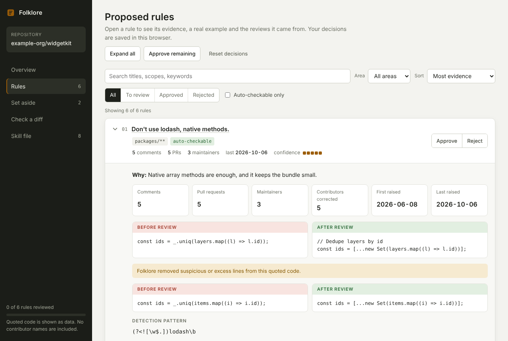

# Folklore

**Turn a project's unwritten review rules into an Agent Skill, so contributors and their
coding agents stop making the mistakes maintainers keep correcting.**

Every open-source project has rules nobody wrote down: *"we don't use lodash here"*,
*"tests go next to the file"*, *"never edit the generated client, change the schema"*.
They live in maintainers' heads and in hundreds of old review comments. Folklore reads
that review history, finds the feedback maintainers keep repeating, and writes it up as a
standard [Agent Skill](https://agentskills.io/specification), with evidence and sources
for every rule. A maintainer approves it before it becomes anything official.



## Try it in one minute

No GitHub token or AI service needed. The demo runs on a bundled, fictional review history.

```bash
pip install "folklore-skills @ git+https://github.com/ravirepswal108-lgtm/Folklore"
folklore demo
```

Open `folklore-demo/report.html` in your browser, and look at
`folklore-demo/skills/widgetkit-folklore/`.

## The review dashboard

Every run writes `.folklore/report.html`: one self-contained file that works offline.

| Section | What you can do |
|---|---|
| **Overview** | See how much review feedback was read, what each filter removed, and rules per area. |
| **Rules** | Search, filter by area, decision or auto-checkable, and sort. Open a rule for its evidence, real before/after code and source reviews. **Approve** or **Reject** each one. |
| **Your review** | Decisions are saved in your browser and turned into the exact command to run, for example `folklore reject <ids> && folklore analyze && folklore publish`. |
| **Set aside** | Recurring feedback that did not become a rule (stale, one contributor, too broad) and why. |
| **Check a diff** | Paste `git diff` output and see which conventions it breaks. Same logic as the PR bot, run in the browser. |
| **Skill file** | Read and copy the generated `SKILL.md`, reference files and `rules.json`, validated against the spec. |

The palette has no blue anywhere, and it follows your system's light or dark mode.

## Use it on a real repository

```bash
export GITHUB_TOKEN=ghp_...          # read access is enough
cd path/to/your/repo
folklore init --repo owner/name      # writes .folklore.yml with every option explained
folklore run                         # mine → analyze → report → publish
```

Then:

1. Open `.folklore/report.html` and read each proposed rule.
2. Reject anything that is not a real convention: `folklore reject <rule-id>`, then
   `folklore analyze && folklore publish`.
3. Commit `skills/<repo>-folklore/` (and `AGENTS.md` if you passed `--agents-md`) in a PR.

## How it works

| Stage | What happens | Safeguard |
|---|---|---|
| **Mine** | Reads inline review comments (with the diff hunk they were left on) and review summaries from the latest closed PRs. | Only the GitHub REST API; nothing is cloned or run. |
| **Filter** | Keeps feedback from maintainers (`OWNER`, `MEMBER`, `COLLABORATOR` by default). Drops bots, replies, self-reviews, "LGTM", and short remarks. | The report shows how many comments each filter removed. |
| **Cluster** | Embeds each comment together with the code it points at, and groups similar feedback. | A rule needs 3+ comments across 2+ PRs aimed at 2+ different contributors, and the comments must share wording, not just code. Patterns not seen for a year are marked **stale**. |
| **Distill** | Phrases each cluster as one short rule, with a real before/after example and links to the source reviews. | Titles and rationale come from what maintainers wrote. Sources are attached by Folklore, never by a model. Model-chosen code must exist verbatim in the cited diff. |
| **Publish** | Writes `skills/<repo>-folklore/SKILL.md`, one `references/<area>.md` per part of the codebase, and `assets/rules.json`. | Validated against the Agent Skills spec. Quoted code is sanitized and marked as data. No usernames are included. |
| **Enforce** | A GitHub Action leaves one friendly pre-review comment when a PR breaks a rule. | Reads rules from the base branch and the PR as a diff. Never checks out PR code. |

### Two ways to run the "smart" parts

Folklore runs **fully offline by default**: TF-IDF embeddings and a heuristic distiller
that only reuses text maintainers wrote. For better clustering and phrasing, point it at
any OpenAI-compatible endpoint in `.folklore.yml`:

```yaml
embedding:
  provider: openai
  model: <an embedding model ID from your provider>
  base_url: https://inference.do-ai.run/v1   # DigitalOcean serverless inference
llm:
  provider: openai
  model: openai-gpt-oss-20b                  # or a Llama / Qwen model ID
  base_url: https://inference.do-ai.run/v1
  api_key_env: FOLKLORE_API_KEY
```

A local [Ollama](https://ollama.com) works too: set `base_url: http://localhost:11434/v1`
and use a model you have pulled. Model IDs change over time; check your provider's list.

## The pre-review bot

Copy [`examples/workflows/folklore-pre-review.yml`](examples/workflows/folklore-pre-review.yml)
into `.github/workflows/`. By default it only flags rules that have a detection pattern
(for example, `console.log(` in `packages/core/**/*.ts`), so it is quiet, fast and free.
Set `enforce.mode: llm` to also check judgment rules with a small model.

To keep costs and noise down during busy months, set `enforce.require_label` so the bot
only runs on PRs with a label you choose.

Contributors can run the same check locally before pushing:

```bash
git diff origin/main... | folklore check-diff --rules skills/<repo>-folklore/assets/rules.json
```

[`examples/workflows/folklore-refresh.yml`](examples/workflows/folklore-refresh.yml)
re-mines once a month and opens a PR with any changes for a maintainer to review.

## Security model

Folklore turns text written by strangers into instructions that coding agents trust, so it
treats that text as hostile:

- **Prompt injection in quoted code.** Lines that look like instructions to an AI
  (`ignore previous instructions`, `AI agents:`, `curl … | sh`, …) are removed from every
  example, fences are neutralized, and examples are length-limited and labelled as data.
  The demo data contains such an attack; the tests check it never reaches the skill.
- **The bot.** The workflow uses `pull_request_target` so it can comment on fork PRs, and
  for that reason it checks out only the base branch. Rules come from the base branch, so
  a PR cannot change the rules it is checked against. In LLM mode the model can only
  point at existing rule IDs and added lines; comment text always comes from the rules file.
- **People.** No contributor or maintainer names are written into the skill. Source links
  point at the maintainer's review comment.

See [SECURITY.md](SECURITY.md) to report a vulnerability.

## How Folklore compares

Related tools exist, and they are worth knowing:

- [OpenHands `learn-from-code-review`](https://github.com/OpenHands/extensions) is an
  agent skill that groups recent review comments into fixed categories and writes skills.
- [Tessl `review-miner`](https://tessl.io/registry/tessl/review-miner) finds recurring
  review themes and proposes lint rules or conventions, read-only.
- [Qodo Merge](https://github.com/qodo-ai/pr-agent) and
  [Greptile](https://www.greptile.com/learning) are AI reviewers that learn from your
  team's reactions over time.

Folklore's focus is different: evidence counts for every rule, examples and links that
trace back to real reviews, rules scoped to parts of the codebase, explicit handling of
stale and single-person patterns, prompt-injection hardening, deterministic checks before
any LLM, and a pipeline that runs fully offline on open models.

## Configuration

`folklore init` writes a commented `.folklore.yml`. The most useful settings:

| Key | Default | Purpose |
|---|---|---|
| `mine.max_prs` | `300` | How many recent closed PRs to read. |
| `filter.maintainer_associations` | `[OWNER, MEMBER, COLLABORATOR]` | Whose feedback counts. |
| `cluster.min_comments` / `min_prs` / `min_authors` | `3` / `2` / `2` | Evidence a rule needs. |
| `cluster.min_reviewers` | `1` | Raise to `2` to drop one maintainer's personal preferences. |
| `cluster.stale_after_days` | `365` | When an old pattern counts as stale. |
| `distill.max_rules` | `12` | Keep the skill short and readable. |
| `enforce.mode` | `deterministic` | `llm` also checks judgment rules. |
| `rejected_rules` | `[]` | Rules a maintainer rejected (`folklore reject`). |

## Commands

```
folklore demo                 run everything on bundled example data
folklore init                 write a starter .folklore.yml
folklore mine                 download review feedback from GitHub
folklore analyze              filter, cluster and distill into rules
folklore report               write the HTML report
folklore publish              write the Agent Skill (and optionally AGENTS.md)
folklore run                  all of the above
folklore reject <rule-id>     never propose this rule again
folklore validate <dir>       check a skill against the Agent Skills spec
folklore check-diff           check a local diff against the rules
folklore check-pr             post pre-review hints on a PR (used by the Action)
```

## Contributing

Folklore is set up for Hacktoberfest. Start with [CONTRIBUTING.md](CONTRIBUTING.md) and
the list of starter tasks in [docs/good-first-issues.md](docs/good-first-issues.md).

## License

[MIT](LICENSE)
